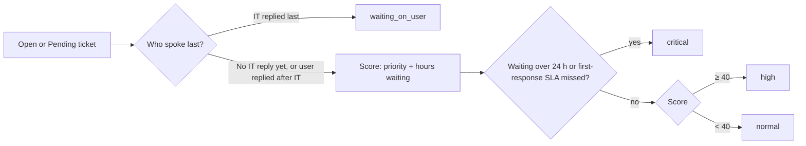

# Atera Triage MCP

**Ask your AI assistant "what needs me first?" and get a real answer from your Atera help desk.**

An [MCP](https://modelcontextprotocol.io) server that turns Atera tickets, devices and alerts into a
ranked to-do list for an IT team. It works with Claude Desktop, Claude Code and any other MCP client.

[](https://github.com/MikeRiveira/atera-triage-mcp/actions/workflows/tests.yml)
[](https://github.com/MikeRiveira/atera-triage-mcp/actions/workflows/codeql.yml)


## Why another Atera MCP server?

Other Atera MCP servers expose the API one endpoint at a time. That lets an AI *read* your help desk,
but it still has to work out on its own which tickets are urgent, and it sees everything users typed,
phone numbers and all.

This server is built for **triage**, the first job of every help desk morning:

| | Endpoint wrappers | Atera Triage MCP |
|---|---|---|
| "What should I work on first?" | AI pulls every ticket and guesses | `triage_queue` ranks them, with reasons |
| Duplicate tickets (HR forms submitted twice) | Shown twice | Folded into one |
| Phone numbers, emails, SSNs in ticket text | Sent to the AI | Removed first |
| "IGNORE PREVIOUS INSTRUCTIONS" in a ticket | Read like any other text | Fenced as untrusted data |
| Changes to tickets | Usually on | Off unless you turn them on |
| Try it without an Atera account | No | Demo mode with sample data |

## Tools

| Tool | What it answers |
|---|---|
| `morning_brief` | One call: open and critical tickets, the top three to handle, offline devices, active alerts |
| `triage_queue` | Every open ticket ranked by urgency, with the reasons, optionally for one site |
| `get_ticket` | One ticket's details and conversation, redacted and fenced |
| `site_health` | Devices per site: how many are online, which are offline and since when |
| `open_alerts` | Active alerts, most severe and newest first |
| `set_ticket_status` | Change a ticket's status. **Only exists when writes are enabled** |

### How tickets are ranked



Every ranked ticket carries plain reasons, such as `first-response SLA missed`,
`waiting on IT over 24 h` or `user replied 40 min ago`, so you can see why it is where it is.
The rules live in [`atera_triage/triage.py`](atera_triage/triage.py) as small pure functions and are
covered by tests.

## Try it in two minutes (demo mode)

With no API key, the server runs on a fictional five-store dealership group: 302 devices, a handful of
offline machines, a duplicate new-hire ticket, an overdue termination ticket, and one ticket that tries a
prompt injection. Nothing touches a real system.

1. Install [uv](https://docs.astral.sh/uv/).
2. Add this to your Claude Desktop config (`claude_desktop_config.json`):

```json
{
  "mcpServers": {
    "atera-triage": {
      "command": "uvx",
      "args": ["--from", "git+https://github.com/MikeRiveira/atera-triage-mcp", "atera-triage-mcp"]
    }
  }
}
```

3. Restart Claude Desktop and ask: **"Give me my morning brief."**

Claude Code users can run:

```bash
claude mcp add atera-triage -- uvx --from git+https://github.com/MikeRiveira/atera-triage-mcp atera-triage-mcp
```

## Connect your Atera account

1. In Atera, go to **Admin > API** and copy your API key.
2. Add it to the config as an environment variable:

```json
{
  "mcpServers": {
    "atera-triage": {
      "command": "uvx",
      "args": ["--from", "git+https://github.com/MikeRiveira/atera-triage-mcp", "atera-triage-mcp"],
      "env": { "ATERA_API_KEY": "your-key-here" }
    }
  }
}
```

| Variable | Default | Meaning |
|---|---|---|
| `ATERA_API_KEY` | *(empty)* | Your Atera API key. Without it, demo mode runs. |
| `ATERA_ALLOW_WRITES` | `false` | Set to `true` to add the `set_ticket_status` tool. |

The key stays on your computer: it is read from the environment, sent only to `app.atera.com`, and never
appears in errors or tool output. An Atera API key has full account access, so keep the config file private.

## Things to ask

- "Give me my morning brief."
- "What tickets at Harbor Point need me first, and why?"
- "Which store has the most machines offline right now?"
- "Summarize ticket 2043 and draft a reply I can send."
- "Are there any critical alerts?"
- With writes on: "Mark ticket 2045 as pending."

## Safety

- **Read-only by default.** The write tool isn't registered at all unless `ATERA_ALLOW_WRITES=true`,
  and every tool carries MCP annotations (`readOnlyHint`, `destructiveHint`) so clients can ask before running it.
- **Privacy.** Contact fields (email, phone) are dropped, requesters appear as "Dana S.", and ticket text is
  scrubbed of phone numbers, email addresses, SSNs and card numbers before the AI sees it.
- **Prompt-injection fencing.** Anything an end user wrote is wrapped in `<ticket_text>` tags, and the server
  tells the model to treat it as data, never as instructions. Users can't close the fence early.
- **Rate limits.** Atera allows 700 requests a minute; the client backs off and retries on HTTP 429.
- **No extra dependencies.** The Atera client uses only the Python standard library; the one dependency is the
  official MCP SDK.

## Development

```bash
git clone https://github.com/MikeRiveira/atera-triage-mcp
cd atera-triage-mcp
pip install -e ".[test]"
python -m pytest
```

Tests cover the ranking rules, redaction and fencing, the API client (pagination, rate-limit retries, a key-safe
401) and every tool in demo mode. They never touch the network.

```
atera_triage/
  client.py    Atera REST API v3 client (stdlib only)
  triage.py    ranking, site health, alerts, morning brief
  privacy.py   redaction, fencing, short names
  demo.py      fictional sample data for demo mode
  server.py    the MCP tools
```

Built against Atera's [REST API v3](https://app.atera.com/apidocs). If Atera returns a field under a different name
on your account, please [open an issue](https://github.com/MikeRiveira/atera-triage-mcp/issues).

## License

MIT. Not affiliated with or endorsed by Atera.
